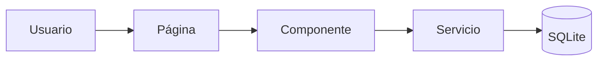

# Arquitectura del Sistema

El sistema sigue una estructura **modular por capas**, separando la interfaz,
la lógica de negocio y el acceso a datos.

## Estructura de carpetas

```text
vinto-ambiental/
├── main.py              # Punto de entrada
├── .env                 # Configuración
├── pages/               # Páginas de la interfaz
├── components/          # Componentes reutilizables (mapa, formulario)
├── models/              # Modelos SQLModel
├── services/            # Lógica de negocio y acceso a datos
└── uploads/             # Fotos subidas por los usuarios
```

## Capas

| Capa | Responsabilidad |
| --- | --- |
| **Páginas** | Definen las rutas y ensamblan los componentes |
| **Componentes** | Elementos de UI reutilizables (mapa Leaflet, formulario) |
| **Servicio** | Crea, lista y consulta reportes; guarda las fotos |
| **Modelo** | Define la tabla de reportes con SQLModel |

## Flujo de datos



!!! tip "Principio de diseño"
    La interfaz nunca habla directo con la base de datos: siempre pasa por el servicio.
