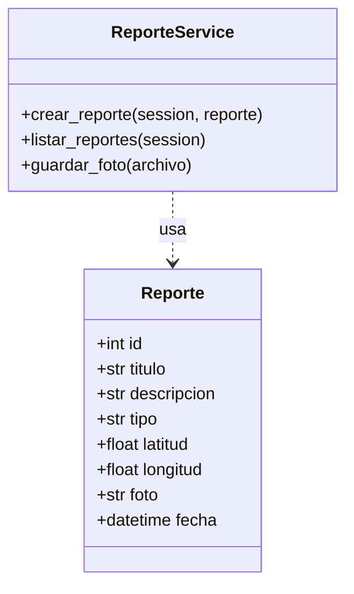

# Diagramas de Clases

## Modelo de datos

## Relaciones

* `ReporteService` depende de `Reporte` para crear y consultar registros.
* Las páginas y componentes dependen del servicio, no del modelo directamente.
