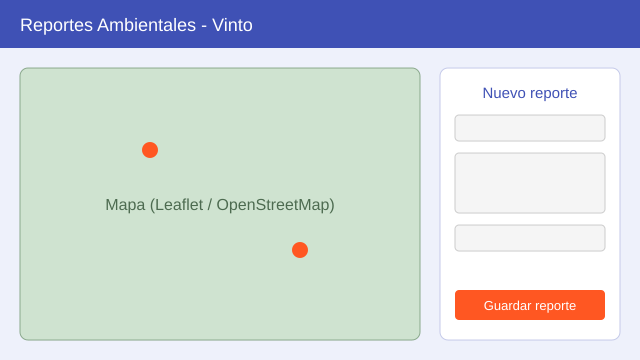

# Guía de Uso

## Registrar un incidente

1. Abre la aplicación en el navegador.
2. Haz clic en el mapa para marcar la ubicación del incidente.
3. Completa el formulario: título, descripción y tipo de incidente.
4. Adjunta una foto con el botón de carga (`ui.upload`).
5. Presiona **Guardar reporte**.

## Consultar reportes

Los reportes guardados aparecen como marcadores en el mapa y en la lista.
Al seleccionar uno se muestran sus datos y su foto.

## Imágenes de ejecución

!!! info "Capturas reales"
    Reemplaza la imagen de ejemplo por tus capturas en `docs/assets/images/`
    y actualiza la ruta en este archivo.
